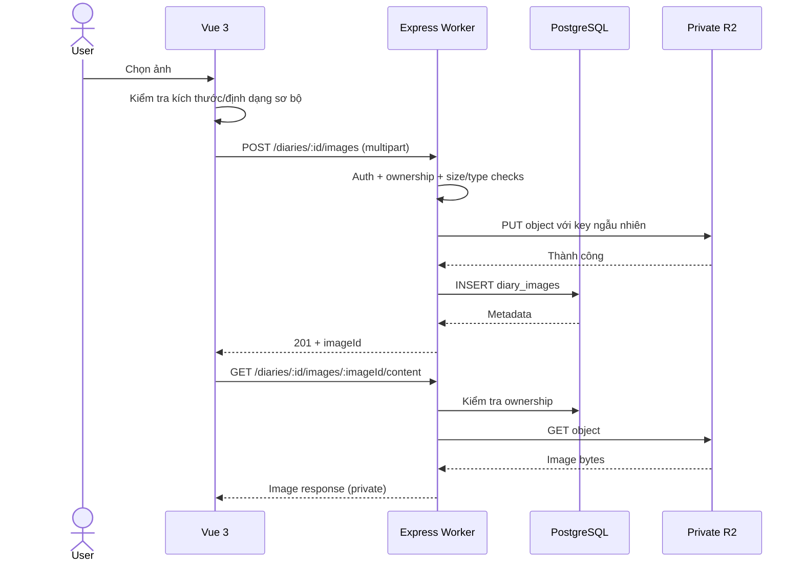

# PRIVATE DIARY --- SYSTEM DESIGN README

> Tài liệu thiết kế kỹ thuật và nghiệp vụ cho ứng dụng web nhật ký cá
> nhân riêng tư.
>
> **Frontend:** Vue 3 + Vite + JavaScript · **Backend:** Node.js +
> Express + JavaScript · **Database:** PostgreSQL + Prisma · **Image
> Storage:** Cloudflare R2 · **Deployment:** Cloudflare Pages + Workers.

**Backend đã triển khai:** [api/README.md](api/README.md) — JavaScript ES
modules, Express, Prisma/PostgreSQL; chạy trực tiếp bằng Node.js 24+.
Hướng dẫn bên dưới về Workers là kiến trúc mục tiêu, chưa phải runtime của
backend hiện tại. API có adapter ảnh local và R2, migration, seed và
integration tests; xem [OpenAPI](api/docs/openapi.yaml).

**Frontend đã triển khai:** [web/README.md](web/README.md) — Vue 3,
JavaScript, Vue Router 4 và Pinia; giao diện tiếng Việt cho auth, nhật ký,
ảnh, lịch, thống kê và cài đặt, kết nối API hiện có. Chạy `npm run dev`
trong `web/` và mở `http://localhost:5173` sau khi khởi động backend.

**Deploy với gói miễn phí:** [Hướng dẫn Cloudflare Pages + Render + Neon + R2](docs/deploy-cloudflare.md) — theo đúng backend Node.js hiện tại, có Pages proxy để cookie đăng nhập hoạt động trên domain `pages.dev`.

## 1. Mục tiêu và phạm vi

Ứng dụng cho phép mỗi người dùng tạo tài khoản và quản lý nhật ký riêng
tư, bao gồm nội dung, cảm xúc, thẻ và ảnh. Không có tính năng chia sẻ
công khai trong MVP. Mọi thao tác đọc/ghi phải xác thực và kiểm tra chủ
sở hữu tại backend.

### MVP

-   Đăng ký, đăng nhập, refresh token, đăng xuất.
-   Hồ sơ người dùng và cấu hình múi giờ.
-   Tạo, xem, sửa, xóa mềm nhật ký; lưu nháp và xuất bản.
-   Một ngày có thể có nhiều nhật ký.
-   Chọn một cảm xúc cho mỗi nhật ký; gắn nhiều thẻ.
-   Upload nhiều ảnh, xem ảnh riêng tư, xóa ảnh; giới hạn số lượng và
    dung lượng.
-   Danh sách, phân trang, tìm kiếm theo tiêu đề/nội dung, lọc ngày/cảm
    xúc/tag.
-   Lịch nhật ký và thống kê cơ bản.

### Ngoài MVP

Chia sẻ xã hội, AI phân tích nhật ký, video, đồng bộ offline, mã hóa đầu
cuối, xuất PDF, thông báo nhắc viết.

## 2. Kiến trúc Cloudflare

``` text
Browser
  │
  ├── https://diary.example.com
  │       └── Cloudflare Pages: Vue 3 / Vite static SPA
  │
  └── https://api.diary.example.com
          └── Cloudflare Workers: Express API (Workers-compatible runtime)
                  ├── Auth / Diary / Mood / Tag / Image services
                  ├── Prisma → Cloudflare Hyperdrive → Managed PostgreSQL
                  └── R2 binding → Private R2 bucket (diary-images)
```

**Lưu ý tương thích:** Cloudflare Workers không phải máy chủ Node.js
truyền thống. Khi triển khai Express trên Workers, phải dùng phiên bản
Express, cơ chế adapter/entrypoint và `nodejs_compat` tương thích với
runtime hiện hành. Kiểm thử trên `wrangler dev` trước khi triển khai.
Không dùng `app.listen()` như một Node server thông thường nếu cấu hình
Workers yêu cầu fetch handler.

**PostgreSQL:** Cloudflare không cung cấp PostgreSQL managed như một
phần của Pages/Workers. Dùng nhà cung cấp PostgreSQL bên ngoài (ví dụ
Neon/Supabase hoặc dịch vụ managed khác), đặt secrets an toàn;
Hyperdrive là lớp kết nối/pooling khi phù hợp. Cấu hình Prisma
adapter/driver theo phiên bản Prisma và cách kết nối Workers thực tế.
Chạy migration từ CI hoặc môi trường Node riêng, không chạy migration ở
mỗi request Worker.

**R2:** Bucket riêng tư, không bật public access. Dùng R2 binding từ
Worker cho MVP; không đưa access key R2 lên trình duyệt.

## 3. Quy tắc nghiệp vụ

  -----------------------------------------------------------------------
  Mã                                  Quy tắc
  ----------------------------------- -----------------------------------
  BR-01                               Mỗi nhật ký thuộc duy nhất một
                                      user; không có truy cập chéo.

  BR-02                               Một user có thể viết nhiều nhật ký
                                      trong cùng ngày.

  BR-03                               `DRAFT` có thể rỗng; `PUBLISHED`
                                      bắt buộc có nội dung không trắng.

  BR-04                               `diaryDate` là ngày theo timezone
                                      của user, khác `createdAt`.

  BR-05                               Nhật ký published không mang ngày
                                      tương lai theo timezone người dùng.

  BR-06                               Mỗi nhật ký có tối đa một mood và
                                      nhiều tags.

  BR-07                               Tag phải thuộc cùng user với nhật
                                      ký.

  BR-08                               Xóa nhật ký là soft delete; ảnh có
                                      chính sách dọn dẹp riêng.

  BR-09                               Mỗi ảnh thuộc một nhật ký và một
                                      user, không truy cập trực tiếp công
                                      khai.

  BR-10                               Ảnh cho phép JPEG/PNG/WebP, tối đa
                                      10 MB/ảnh, 10 ảnh/nhật ký (cấu hình
                                      được).

  BR-11                               Mọi ID tài nguyên từ client phải
                                      được kiểm tra ownership ở backend.

  BR-12                               Không log nội dung nhật ký, cookie,
                                      access token hay bytes ảnh.
  -----------------------------------------------------------------------

## 4. Công nghệ

  Thành phần   Đề xuất
  ------------ ----------------------------------------------------
  Frontend     Vue 3 Composition API, Vite, TypeScript
  State        Pinia (auth/UI), TanStack Vue Query (server state)
  Routing      Vue Router
  Forms        vee-validate + Zod (hoặc Zod trực tiếp)
  UI           Tailwind CSS, component library tùy chọn
  Editor       Textarea cho MVP; Tiptap/Vue sau
  Backend      Express + JavaScript + Zod
  Auth         JWT access token ngắn hạn, refresh token xoay vòng
  Password     Argon2id hoặc bcrypt phù hợp runtime
  ORM          Prisma (phiên bản/driver tương thích Workers)
  DB           PostgreSQL
  Images       Cloudflare R2 private bucket
  Hosting      Cloudflare Pages + Cloudflare Workers
  Tests        Vitest, API integration tests, Playwright

## 5. Database (Prisma --- logical schema)

> Schema dưới đây là **mô hình dữ liệu tham chiếu**, theo cú pháp Prisma
> truyền thống. Với Prisma 7, cần đặt URL datasource trong
> `prisma.config.ts` và cấu hình client/adapter tương thích Workers;
> không copy nguyên cấu hình kết nối cũ vào production.

``` prisma
enum DiaryStatus {
  DRAFT
  PUBLISHED
}

model User {
  id           String @id @default(uuid()) @db.Uuid
  email        String @unique @db.VarChar(255)
  passwordHash String @map("password_hash") @db.VarChar(255)
  displayName  String? @map("display_name") @db.VarChar(150)
  createdAt    DateTime @default(now()) @map("created_at") @db.Timestamptz(6)
  updatedAt    DateTime @updatedAt @map("updated_at") @db.Timestamptz(6)

  diaries Diary[]
  tags Tag[]
  tokens RefreshToken[]
  settings UserSetting?

  @@map("users")
}

model UserSetting {
  userId   String @id @map("user_id") @db.Uuid
  timezone String @default("Asia/Ho_Chi_Minh") @db.VarChar(100)
  theme    String @default("SYSTEM") @db.VarChar(20)

  user User @relation(fields: [userId], references: [id], onDelete: Cascade)
  @@map("user_settings")
}

model Diary {
  id        String @id @default(uuid()) @db.Uuid
  userId    String @map("user_id") @db.Uuid
  moodId    String? @map("mood_id") @db.Uuid
  title     String? @db.VarChar(255)
  content   String @default("") @db.Text
  diaryDate DateTime @map("diary_date") @db.Date
  status    DiaryStatus @default(DRAFT)
  createdAt DateTime @default(now()) @map("created_at") @db.Timestamptz(6)
  updatedAt DateTime @updatedAt @map("updated_at") @db.Timestamptz(6)
  deletedAt DateTime? @map("deleted_at") @db.Timestamptz(6)

  user   User @relation(fields: [userId], references: [id], onDelete: Cascade)
  mood   Mood? @relation(fields: [moodId], references: [id], onDelete: SetNull)
  tags   DiaryTag[]
  images DiaryImage[]

  @@index([userId, diaryDate(sort: Desc)])
  @@index([userId, status])
  @@map("diaries")
}

model Mood {
  id String @id @default(uuid()) @db.Uuid
  code String @unique @db.VarChar(30)
  name String @db.VarChar(100)
  emoji String @db.VarChar(20)
  score Int
  diaries Diary[]
  @@map("moods")
}

model Tag {
  id String @id @default(uuid()) @db.Uuid
  userId String @map("user_id") @db.Uuid
  name String @db.VarChar(50)
  user User @relation(fields: [userId], references: [id], onDelete: Cascade)
  diaries DiaryTag[]
  @@unique([userId, name])
  @@map("tags")
}

model DiaryTag {
  diaryId String @map("diary_id") @db.Uuid
  tagId String @map("tag_id") @db.Uuid
  diary Diary @relation(fields: [diaryId], references: [id], onDelete: Cascade)
  tag Tag @relation(fields: [tagId], references: [id], onDelete: Cascade)
  @@id([diaryId, tagId])
  @@index([tagId])
  @@map("diary_tags")
}

model DiaryImage {
  id String @id @default(uuid()) @db.Uuid
  diaryId String @map("diary_id") @db.Uuid
  userId String @map("user_id") @db.Uuid
  objectKey String @unique @map("object_key") @db.VarChar(500)
  originalName String? @map("original_name") @db.VarChar(255)
  mimeType String @map("mime_type") @db.VarChar(100)
  sizeBytes Int @map("size_bytes")
  sortOrder Int @default(0) @map("sort_order")
  createdAt DateTime @default(now()) @map("created_at") @db.Timestamptz(6)

  diary Diary @relation(fields: [diaryId], references: [id], onDelete: Cascade)
  @@index([userId, diaryId])
  @@map("diary_images")
}

model RefreshToken {
  id String @id @default(uuid()) @db.Uuid
  userId String @map("user_id") @db.Uuid
  tokenHash String @unique @map("token_hash") @db.VarChar(255)
  expiresAt DateTime @map("expires_at") @db.Timestamptz(6)
  revokedAt DateTime? @map("revoked_at") @db.Timestamptz(6)
  createdAt DateTime @default(now()) @map("created_at") @db.Timestamptz(6)

  user User @relation(fields: [userId], references: [id], onDelete: Cascade)
  @@index([userId])
  @@map("refresh_tokens")
}
```

**Index bổ sung bằng SQL migration:**

``` sql
CREATE INDEX idx_diaries_active_user_date
ON diaries(user_id, diary_date DESC)
WHERE deleted_at IS NULL;
```

**Lưu ý quan hệ ảnh:** `DiaryImage.userId` hỗ trợ lọc nhanh, nhưng
backend phải đảm bảo `image.userId == diary.userId`. Có thể tăng cường
bằng composite foreign key hoặc transaction. `objectKey` là định danh
nội bộ, không phải URL công khai.

## 6. Thiết kế API REST

Base URL: `/api/v1`

Thiết kế request/response, validation, phiên đăng nhập, upload và các ca
nghiệm thu: [api/docs/api-design.md](api/docs/api-design.md). Đặc tả 23 endpoint
để frontend/backend dùng chung: [api/docs/openapi.yaml](api/docs/openapi.yaml).
Hướng dẫn chạy bản JavaScript: [api/README.md](api/README.md).

### Auth / User

  Method   Path               Mô tả
  -------- ------------------ ---------------------------
  POST     `/auth/register`   Đăng ký
  POST     `/auth/login`      Đăng nhập
  POST     `/auth/refresh`    Xoay vòng refresh token
  POST     `/auth/logout`     Thu hồi phiên
  GET      `/users/me`        Thông tin cá nhân
  PATCH    `/users/me`        Cập nhật profile/settings

### Diaries

  Method   Path                                     Mô tả
  -------- ---------------------------------------- ---------------------
  POST     `/diaries`                               Tạo nhật ký
  GET      `/diaries`                               Danh sách và bộ lọc
  GET      `/diaries/:id`                           Chi tiết
  PATCH    `/diaries/:id`                           Cập nhật
  DELETE   `/diaries/:id`                           Soft delete
  GET      `/diaries/calendar?year=2026&month=10`   Tổng hợp theo ngày
  GET      `/diaries/statistics`                    Thống kê

Query danh sách: `page`, `limit`, `keyword`, `status`, `moodId`,
`tagId`, `fromDate`, `toDate`, `sort`. Luôn giới hạn `limit` tối đa (ví
dụ 50).

### Moods / Tags

  Method   Path          Mô tả
  -------- ------------- -----------------
  GET      `/moods`      Danh mục mood
  GET      `/tags`       Tags thuộc user
  POST     `/tags`       Tạo tag
  PATCH    `/tags/:id`   Sửa tag
  DELETE   `/tags/:id`   Xóa tag

### Images (private)

  ----------------------------------------------------------------------------------------
  Method                  Path                                     Mô tả
  ----------------------- ---------------------------------------- -----------------------
  POST                    `/diaries/:id/images`                    Upload
                                                                   `multipart/form-data`
                                                                   với field `file`

  GET                     `/diaries/:id/images`                    Liệt kê metadata ảnh

  GET                     `/diaries/:id/images/:imageId/content`   Stream bytes ảnh đã xác
                                                                   thực

  DELETE                  `/diaries/:id/images/:imageId`           Xóa metadata và lên
                                                                   lịch xóa R2

  PATCH                   `/diaries/:id/images/order`              Sắp xếp thứ tự ảnh (tùy
                                                                   chọn)
  ----------------------------------------------------------------------------------------

**Ví dụ tạo nhật ký:**

``` json
{
  "title": "Một ngày đáng nhớ",
  "content": "Hôm nay mình...",
  "diaryDate": "2026-10-23",
  "status": "PUBLISHED",
  "moodId": "uuid",
  "tagIds": ["uuid"]
}
```

**Response chuẩn:**

``` json
{
  "success": true,
  "data": {},
  "meta": {}
}
```

**Response lỗi:**

``` json
{
  "success": false,
  "error": {
    "code": "FORBIDDEN",
    "message": "Không có quyền truy cập"
  }
}
```

Mã HTTP: `200`, `201`, `204`, `400`, `401`, `403`, `404`, `409`, `413`,
`415`, `429`, `500`. Truy cập ID nhật ký người khác nên trả `404` để hạn
chế tiết lộ sự tồn tại.

## 7. Thiết kế upload ảnh Cloudflare R2

### 7.1. Luồng upload MVP



**R2 object key đề xuất:**

``` text
diaries/{userId}/{diaryId}/{randomUUID}.webp
```

Không dùng tên file gốc làm object key. Có thể giữ định dạng gốc nếu
chưa có pipeline chuyển đổi; khi đó phần mở rộng phải phản ánh loại file
đã xác minh.

### 7.2. Quy tắc xử lý ảnh

1.  Kiểm tra người dùng và quyền sở hữu nhật ký **trước** khi đọc toàn
    bộ upload.
2.  Giới hạn 10 MB/ảnh, 10 ảnh/nhật ký; cấu hình giới hạn request/Worker
    phù hợp.
3.  Kiểm tra MIME khai báo **và** chữ ký nội dung; không tin đuôi file.
4.  Chỉ nhận JPEG, PNG, WebP; từ chối SVG và nội dung thực thi.
5.  Cân nhắc xử lý lại ảnh và loại bỏ EXIF (tọa độ GPS) trước khi lưu;
    nếu chưa làm, ghi rõ giới hạn quyền riêng tư.
6.  Dùng `crypto.randomUUID()` tạo key; không để lộ `objectKey` ra
    frontend.
7.  Nếu R2 PUT thành công nhưng DB INSERT lỗi, xóa object bù; có job dọn
    orphan định kỳ.
8.  Xóa ảnh theo cơ chế có thể retry (outbox/job hoặc đánh dấu chờ xóa)
    để tránh DB/R2 mất đồng bộ.
9.  Với GET ảnh, xác thực, kiểm tra ownership, trả
    `Cache-Control: private, no-store` trong MVP; không sử dụng public
    CDN URL.
10. Trên frontend, tải ảnh với request có Authorization và chuyển thành
    Blob URL; gọi `URL.revokeObjectURL()` khi không dùng nữa. Tránh đặt
    bearer token trong URL.
11. Không log ảnh, bytes ảnh hoặc URL chứa token.

**Lưu ý:** Ảnh riêng tư phục vụ qua Worker có chi phí request và
bandwidth. Khi mở rộng có thể cân nhắc signed URL ngắn hạn nếu thiết kế
bảo mật phù hợp, nhưng không mặc định biến bucket thành public.

## 8. Frontend Vue 3 + Vite

### 8.1. Routes

  Route                 View              Auth
  --------------------- ----------------- -------
  `/login`              LoginView         Guest
  `/register`           RegisterView      Guest
  `/dashboard`          DashboardView     User
  `/diaries`            DiaryListView     User
  `/diaries/new`        DiaryEditorView   User
  `/diaries/:id`        DiaryDetailView   User
  `/diaries/:id/edit`   DiaryEditorView   User
  `/calendar`           CalendarView      User
  `/statistics`         StatisticsView    User
  `/settings`           SettingsView      User

### 8.2. Cấu trúc dự án

``` text
private-diary/
├── apps/
│   ├── web/
│   │   ├── src/
│   │   │   ├── app/
│   │   │   │   ├── router/
│   │   │   │   └── providers/
│   │   │   ├── assets/
│   │   │   ├── components/
│   │   │   │   ├── ui/
│   │   │   │   └── layout/
│   │   │   ├── features/
│   │   │   │   ├── auth/
│   │   │   │   ├── diaries/
│   │   │   │   │   ├── api/
│   │   │   │   │   ├── components/
│   │   │   │   │   ├── composables/
│   │   │   │   │   ├── views/
│   │   │   │   │   └── types/
│   │   │   │   ├── images/
│   │   │   │   ├── moods/
│   │   │   │   ├── tags/
│   │   │   │   ├── calendar/
│   │   │   │   └── statistics/
│   │   │   ├── stores/
│   │   │   ├── lib/
│   │   │   ├── App.vue
│   │   │   └── main.ts
│   │   ├── public/
│   │   ├── index.html
│   │   ├── vite.config.ts
│   │   └── package.json
│   └── api/
│       ├── src/
│       │   ├── worker.ts
│       │   ├── app.ts
│       │   ├── common/
│       │   │   ├── middleware/
│       │   │   ├── errors/
│       │   │   └── validation/
│       │   ├── modules/
│       │   │   ├── auth/
│       │   │   ├── users/
│       │   │   ├── diaries/
│       │   │   ├── images/
│       │   │   ├── moods/
│       │   │   └── tags/
│       │   └── db/
│       ├── prisma/
│       │   ├── schema.prisma
│       │   └── migrations/
│       ├── wrangler.jsonc
│       └── package.json
├── packages/
│   └── shared/
│       └── src/    # API types + validation schemas dùng chung
├── .github/workflows/
├── package.json
└── README.md
```

### 8.3. Vue composables

-   `useAuth()`: session, login, logout, refresh.
-   `useDiaries(filters)`: danh sách và cache.
-   `useDiary(id)`: chi tiết.
-   `useCreateDiary()`, `useUpdateDiary()`, `useDeleteDiary()`.
-   `useDiaryImages(diaryId)`: upload, preview, remove, revoke Blob
    URLs.
-   `useCalendar(year, month)`.
-   `useMoods()`, `useTags()`.

**UI màn hình Diary Editor:** tiêu đề, ngày, textarea/editor, mood
picker, tag selector, ảnh dạng thumbnail có tiến độ upload và nút xóa,
lưu nháp/xuất bản. Upload ảnh chỉ khi nhật ký đã có `id`; với bài mới,
tạo nháp trước rồi upload ảnh.

**Lưu ý Vue:** dùng Composition API với `<script setup lang="ts">`;
Pinia dành cho auth/UI, TanStack Vue Query cho dữ liệu server. Route
guards chỉ cải thiện UX, không phải lớp bảo mật.

## 9. Backend Express

### Layer

``` text
HTTP Route → Auth/Validation Middleware → Controller
           → Service (business rules)
           → Repository/Prisma → PostgreSQL
           → R2 Service (images)
```

### Các kiểm tra bắt buộc

-   Mọi query diary chứa `userId` đã xác thực và `deletedAt: null`.
-   Update/delete phải kiểm tra ownership trong chính điều kiện ghi;
    tránh check rồi update theo ID không ràng buộc.
-   Validate request bằng Zod, phân trang có giới hạn.
-   Khi thêm tag, xác minh tất cả `tagIds` thuộc user.
-   Kiểm tra mood tồn tại.
-   `diaryDate` sử dụng định dạng date-only (`YYYY-MM-DD`), tránh lệch
    ngày khi serialize.
-   Transaction cho thay đổi DB nhiều bảng.
-   Không bao giờ cho client truyền `userId` làm chủ sở hữu.
-   Với Express trên Workers, kiểm tra khả năng streaming upload,
    multipart parser, Web Streams, giới hạn memory/CPU và R2 bindings
    trước khi chọn thư viện.

## 10. Authentication và bảo mật

-   Password hash Argon2id/bcrypt phù hợp runtime.
-   Access JWT thời gian ngắn; refresh token ngẫu nhiên, hash trong DB,
    rotate mỗi lần refresh, phát hiện reuse và thu hồi phiên khi cần.
-   Refresh token ở cookie `HttpOnly; Secure; SameSite` phù hợp domain;
    nếu dùng cookie xuyên site phải thiết kế CSRF protection.
-   Access token lưu trong memory, không lưu trong `localStorage`.
-   CORS chỉ cho origin frontend được phép; `credentials` nếu dùng
    cookie.
-   Rate limit login/register/upload; kiểm soát kích thước request.
-   HTTPS bắt buộc trên production; secrets chỉ lưu trong Worker secrets
    / CI secrets.
-   Headers bảo mật, chống XSS, CSRF, injection; sanitize rich text nếu
    triển khai.
-   Private R2 bucket, kiểm tra quyền khi đọc ảnh.
-   Không ghi nhật ký người dùng vào analytics hoặc error logs.
-   Có chính sách backup/restore PostgreSQL và xử lý xóa dữ liệu cá
    nhân.
-   **Không tuyên bố mã hóa đầu cuối:** mô hình này cho phép backend xử
    lý plaintext; nếu muốn E2EE cần thiết kế riêng.

## 11. Deploy Cloudflare

### 11.1. Frontend --- Cloudflare Pages

-   Kết nối Git repository.
-   Root directory: `apps/web` (nếu monorepo).
-   Build command: `npm run build` (hoặc workspace command tương ứng).
-   Output directory: `dist`.
-   Environment variable:
    `VITE_API_BASE_URL=https://api.diary.example.com/api/v1`.
-   Cấu hình SPA fallback để các URL Vue Router history mode không trả
    404 khi refresh.
-   Gắn custom domain `diary.example.com`.

**Chú ý:** Biến `VITE_*` được nhúng vào bundle public, không đặt secrets
tại đây.

### 11.2. Backend --- Cloudflare Workers

-   Cấu hình `wrangler.jsonc` trong `apps/api`.
-   Bật `nodejs_compat` khi thư viện sử dụng Node APIs được Workers hỗ
    trợ.
-   Khai báo R2 binding, ví dụ `DIARY_IMAGES`.
-   Khai báo Hyperdrive binding (nếu sử dụng).
-   Thiết lập secrets như JWT signing key, database config cần thiết.
-   Thiết lập custom domain `api.diary.example.com`.
-   Xác minh Express entrypoint/adapter tương thích Workers và Prisma
    driver/adapter phù hợp trước khi deploy.

Ví dụ cấu hình minh họa (thay ID thực tế):

``` jsonc
{
  "name": "private-diary-api",
  "main": "src/worker.ts",
  "compatibility_date": "2026-10-01",
  "compatibility_flags": ["nodejs_compat"],
  "r2_buckets": [
    {
      "binding": "DIARY_IMAGES",
      "bucket_name": "private-diary-images"
    }
  ],
  "hyperdrive": [
    {
      "binding": "HYPERDRIVE",
      "id": "<YOUR_HYPERDRIVE_ID>"
    }
  ]
}
```

`worker.ts` phải xuất fetch handler phù hợp với adapter Express/Workers
đã chọn. Cấu hình trên là khung tham khảo, chưa đủ để chạy nếu chưa có
entrypoint và database adapter.

### 11.3. CI/CD

``` text
Pull Request
  → lint + typecheck
  → unit/integration tests
  → build Vue + API
  → preview deployment

Merge main
  → DB migration (job Node riêng, kiểm soát thứ tự)
  → deploy Worker API
  → deploy Pages frontend
  → smoke test
```

Không chạy `prisma migrate dev` trong production; sử dụng quy trình
`prisma migrate deploy` từ môi trường có quyền kết nối DB.

### 11.4. Local development

``` text
Vue Vite dev server:  http://localhost:5173
API Wrangler dev:     http://localhost:8787
PostgreSQL local:     localhost:5432
R2:                   local emulation hoặc remote dev bucket riêng
```

Nên có `.env.example` cho frontend/API nhưng tuyệt đối không commit
secrets thật. Với R2 remote dev, tạo bucket riêng để tránh ảnh thử
nghiệm lẫn với production.

## 12. Kiểm thử nghiệm thu

  Test                                         Kỳ vọng
  -------------------------------------------- -------------------------------------
  User A đọc nhật ký User B                    404
  User A xem ảnh User B                        404
  Upload file giả MIME JPEG nhưng bytes khác   415
  Upload ảnh \> 10 MB                          413
  Upload quá 10 ảnh                            400/409
  Upload thành công R2, DB thất bại            Cleanup object
  Xóa nhật ký                                  Không xuất hiện trong danh sách/ảnh
  Refresh token bị revoke                      401
  Tag thuộc user khác                          Từ chối
  Nhật ký `PUBLISHED` nội dung rỗng            400
  Reload trực tiếp `/diaries/:id`              SPA tải được
  Đổi timezone                                 Không lệch `diaryDate`
  R2 bucket không public                       Truy cập trực tiếp không hợp lệ
  Upload cùng tên file                         Không ghi đè nhờ key ngẫu nhiên

## 13. Roadmap

**Sprint 1:** Monorepo, PostgreSQL, Prisma, auth, Vue auth screens.

**Sprint 2:** Diary CRUD, mood, tags, tìm kiếm, phân trang, Diary
Editor.

**Sprint 3:** R2 image upload/private serving, gallery, calendar,
statistics.

**Sprint 4:** Test ownership/security, Cloudflare Pages/Workers
deployment, backup, logging và kiểm thử production.

## 14. Quyết định kỹ thuật cần chốt trước khi triển khai

1.  **PostgreSQL provider:** Neon, Supabase hoặc dịch vụ managed khác;
    kiểm tra khu vực và phương án Hyperdrive.
2.  **Prisma version:** chốt phiên bản cùng driver adapter được Workers
    hỗ trợ; cập nhật generator/config theo phiên bản.
3.  **Express on Workers:** xác minh phiên bản, adapter và hỗ trợ
    multipart/streaming qua prototype.
4.  **Ảnh:** MVP giữ file gốc đã kiểm tra hay chuyển WebP và loại bỏ
    EXIF.
5.  **Dọn R2:** cơ chế cleanup/orphan reconciliation (cron Worker hoặc
    queue).
6.  **Domain/cookie:** chốt `diary.example.com` và
    `api.diary.example.com` để thiết kế auth, CORS và CSRF chính xác.
7.  **Backup/retention:** thời gian giữ nhật ký đã xóa và cách khôi
    phục.

------------------------------------------------------------------------

**Nguyên tắc kiến trúc:** ưu tiên MVP dễ vận hành, riêng tư theo mặc
định, quyền truy cập kiểm tra ở server, tách metadata PostgreSQL khỏi
file R2, và không phụ thuộc vào các giả định về Node runtime trên
Cloudflare Workers.
